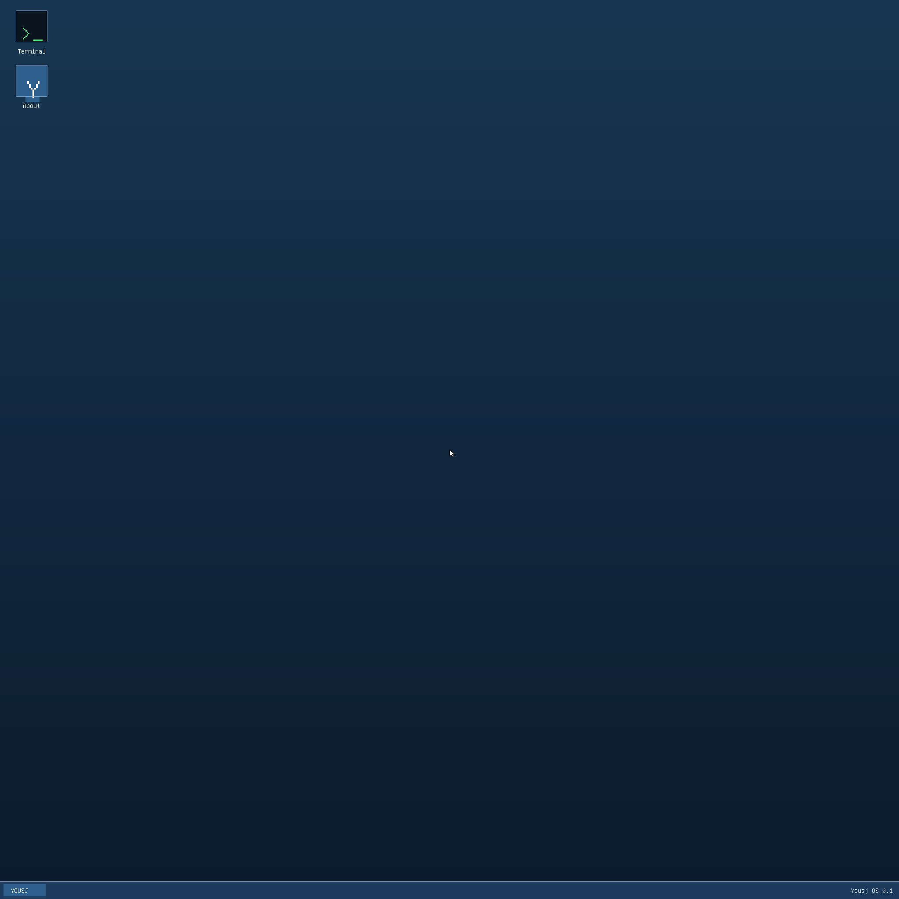
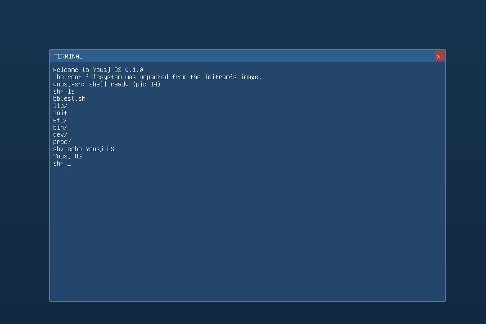
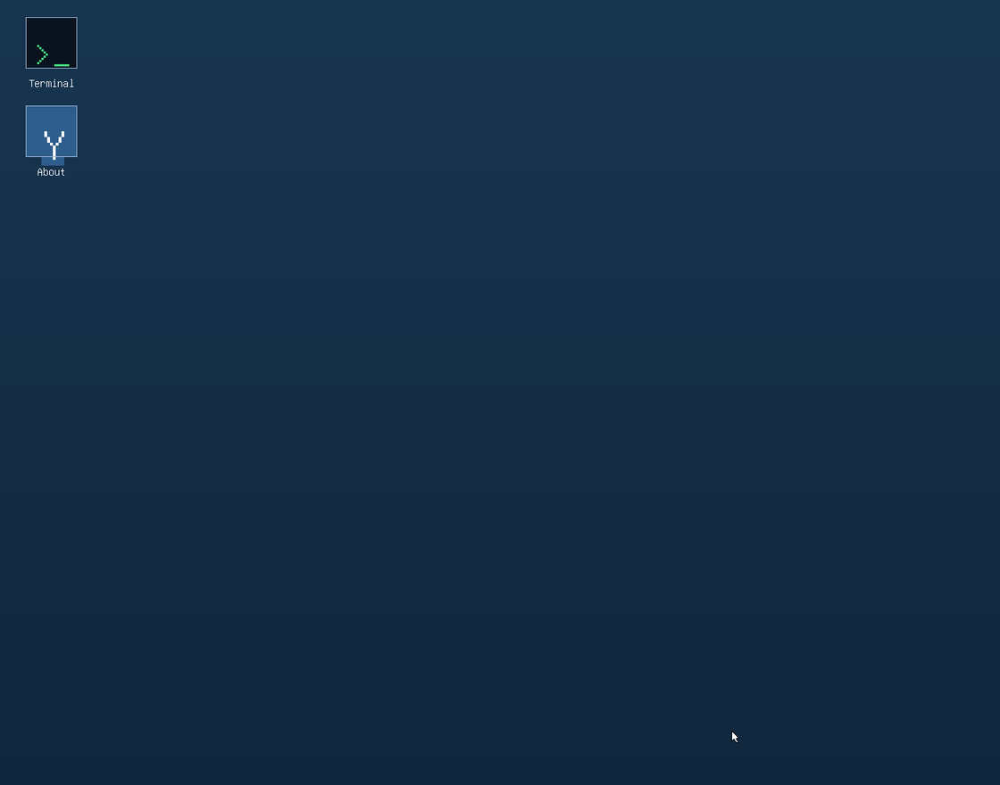

English | [简体中文](README.zh-CN.md)

# Yousj OS

An operating system written from scratch. It is not based on the
Linux kernel and uses not a single line of Linux kernel code. To
run Linux programs, the kernel implements a Linux-compatible
system call interface — interface-compatible, independently
written, the same way Wine runs Windows programs without being
Windows.

One kernel, two forms: a desktop edition with a graphical
interface, and a headless server edition with a command line
only.







## What it can do today

- **Boot**: a from-scratch UEFI bootloader that sets up a GOP
  graphics mode and loads the kernel
- **Processes and threads**: clone / fork / vfork / execve /
  wait4, pthreads, futexes, signals, process groups and job
  control, robust futexes
- **Memory**: four-level page tables, demand-paged mmap, a
  private address space per process
- **Filesystems**: yfs, a from-scratch persistent filesystem
  with a write-ahead journal; ramfs; a generated /proc; /dev
  character devices; PTY pairs; inotify; epoll
- **Networking**: a virtio-net driver (PCI + INTx interrupts),
  ARP, IPv4, ICMP, UDP and a complete TCP state machine; a BSD
  sockets interface including AF_UNIX; a DHCP client brings
  the interface up on a real network automatically
- **Real Linux programs**: dynamically and statically linked
  musl programs run, and the full Alpine busybox applet family
  (about 300 applets) works in the system day to day
- **Desktop**: gradient wallpaper, desktop icons (single click
  selects, double click launches), draggable windows, a taskbar
  with a start menu, and a graphical terminal — a real shell on
  a PTY inside a window
- **Server form**: with no graphics device present, the same
  kernel comes up with a serial console only

## Download and run

Grab the latest ISO from
[Releases](https://github.com/yousj666/yousj-os/releases) and
boot it in QEMU (adjust the OVMF paths to your machine):

```sh
qemu-system-x86_64 -machine q35 -m 256 \
  -drive if=pflash,format=raw,readonly=on,file=OVMF_CODE_4M.fd \
  -drive if=pflash,format=raw,file=OVMF_VARS_4M.fd \
  -cdrom yousj-os-0.1.0.iso -serial stdio
```

It boots straight to the desktop: double-click the Terminal
icon for a shell window, the About icon shows system
information. A command-line shell is also live on the serial
console.

## Building from source

You need three things: `gcc`, `make` and `qemu-system-x86_64`
(plus OVMF firmware for the UEFI boot chain).

```sh
make kernel   # the kernel
make image    # bootable disk image  dist/yousj-os-0.1.0.img
make iso      # bootable CD image    dist/yousj-os-0.1.0.iso
make check    # static checks
make test     # host-side unit tests
```

## Code layout

| Directory | Contents |
| --- | --- |
| `bootloader/` | UEFI bootloader (talks to UEFI protocols directly) |
| `kernel/` | The kernel: scheduler, memory, filesystems, networking, drivers, GUI |
| `userland/` | init, the shell, the graphical terminal and bundled programs |
| `tools/` | Image builders and the QEMU acceptance suites |
| `docs/` | Design documents |

The kernel and userland are mostly C, with small amounts of
assembly at the boot and interrupt entry points; the image
tools are Python.

## License

MIT — see [LICENSE](LICENSE).
