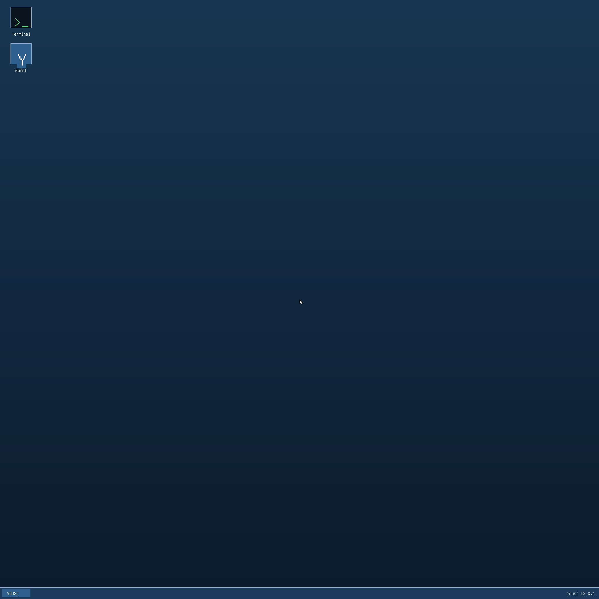
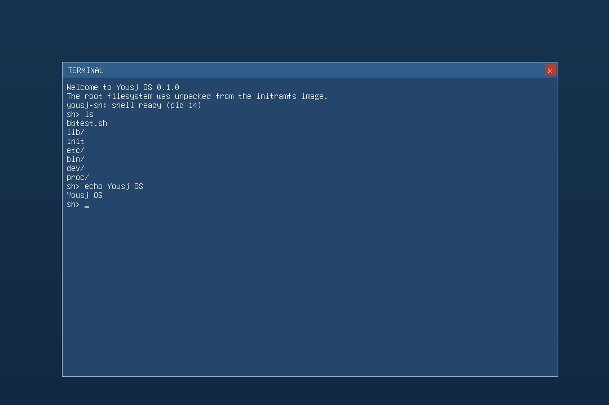

[English](README.md) | 简体中文

# Yousj OS

从零写的独立操作系统。不基于 Linux 内核，不用一行 Linux 内核源码；
为了能跑 Linux 程序，内核实现了一套与 Linux 兼容的系统调用接口——
接口兼容，代码独立，就像 Wine 跑 Windows 程序不等于 Windows。

同一个内核有两种形态：带桌面图形界面的桌面版，和只有命令行的
无头服务器版。






## 它现在能做什么

- **启动**：自研 UEFI 引导器，设置 GOP 图形模式后把内核拉起来
- **进程与线程**：clone / fork / vfork / execve / wait4、pthread、
  futex、信号、进程组与作业控制、稳健锁（robust futex）
- **内存**：四级页表、按需分页的 mmap、每进程独立地址空间
- **文件系统**：自研 yfs 持久文件系统（预写日志）、ramfs、
  生成式 /proc、/dev 字符设备、伪终端 PTY、inotify、epoll
- **网络**：virtio-net 网卡驱动（PCI + INTx 中断）、ARP、IPv4、
  ICMP、UDP、完整 TCP 状态机；BSD 套接字接口，含 AF_UNIX；
  带 DHCP 客户端，能在真实网络里自动获取地址联网
- **跑真 Linux 程序**：动态与静态链接的 musl 程序都能跑，
  Alpine busybox 全家桶（约 300 个 applet）在系统里日常工作
- **桌面**：渐变壁纸、桌面图标（单击选中、双击启动）、可拖动
  的窗口、任务栏与开始菜单、图形终端——窗口里是带 PTY 的
  真 shell
- **服务器形态**：无图形时自动只有串口控制台，内核不变

## 下载与运行

到 [Releases](https://github.com/yousj666/yousj-os/releases)
下载最新版 ISO，用 QEMU 启动（把 OVMF 路径换成你机器上的）：

```sh
qemu-system-x86_64 -machine q35 -m 256 \
  -drive if=pflash,format=raw,readonly=on,file=OVMF_CODE_4M.fd \
  -drive if=pflash,format=raw,file=OVMF_VARS_4M.fd \
  -cdrom yousj-os-0.1.0.iso -serial stdio
```

开机后就是桌面：双击 Terminal 图标打开终端，About 图标是
系统信息。串口上同时有一个命令行 shell。

## 从源码构建

依赖三样：`gcc`、`make`、`qemu-system-x86_64`（UEFI 固件
OVMF 需另备）。

```sh
make kernel   # 内核
make image    # 可启动磁盘镜像 dist/yousj-os-0.1.0.img
make iso      # 可启动光盘镜像 dist/yousj-os-0.1.0.iso
make check    # 静态检查
make test     # 宿主机单元测试
```

## 代码结构

| 目录 | 内容 |
| --- | --- |
| `bootloader/` | UEFI 引导器（直接调用 UEFI 协议） |
| `kernel/` | 内核：调度、内存、文件系统、网络、驱动、GUI |
| `userland/` | init、shell、图形终端及系统自带程序 |
| `tools/` | 镜像制作工具与 QEMU 自动化验收套件 |
| `docs/` | 设计文档 |

内核与用户程序以 C 为主，引导与中断入口含少量汇编，
镜像工具为 Python。

## 许可

MIT，见 [LICENSE](LICENSE)。
